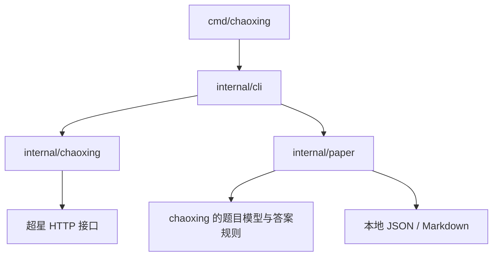

# 项目结构

```text
cmd/chaoxing/
  main.go                  进程入口、信号处理、退出码
internal/
  cli/
    schema.go              命令及参数定义、解析
    execute.go             命令调度、终端密码输入、文件输出
    response.go            输出模式调度、JSON 响应、错误与退出码映射
    text.go                TTY 自动选择、中文表格、题目与进度展示
    text_test.go           文本输出、中文列宽、事件与模式选择测试
    cli_test.go            CLI 契约与本地试卷流程测试
  chaoxing/
    client.go              HTTP、Cookie、移动端 UA
    auth.go                账号密码登录、会话检查
    course.go              课程、章节、任务点计数
    task.go                卡片枚举、附件刷新、任务定位、参数签名
    quiz.go                章节测验页面解析与指定答案提交
    study.go               视频／音频／文档学习流程与上报
    exam.go                已进入考试会话的整卷读取
    model.go               课程、任务、题目与试卷模型
    answer.go              题型答案校验与内部选项键归一化
    errors.go              结构化业务错误
    html.go                页面解析与 AttachmentSetting 提取
    *_test.go              按协议模块组织的 HTTP／解析测试
  paper/
    file.go                CxStudy／标准 JSON、答案文件、Markdown
    file_test.go           选项顺序与试卷往返读写测试
examples/
  exam.json                示例试卷
  answers.json             按题目 ID 提供的示例答案
UPSTREAM.md                固定上游版本、源码对应表、差异和更新步骤
NOTICE                     来源与版权说明
VALIDATION.md              已完成的验证及边界
```

## 调用关系



CLI 负责参数、确认要求、输入输出和业务调用。`chaoxing` 负责超星协议及相关学习流程，任务令牌和提交表单保留为包内字段；该包不读取终端、不直接打印响应。`paper` 复用题目模型与答案规则，处理本地文件时不创建 HTTP 客户端。入口只负责进程生命周期。

## 修改位置

- 登录、接口参数、HTML 或任务完成判定变化：修改 `internal/chaoxing` 对应文件及测试，上游位置见 [UPSTREAM.md](../UPSTREAM.md)。
- 命令、参数和输出约定变化：修改 `internal/cli`，同时更新 README 命令示例。
- CxStudy JSON 格式或本地试卷转换变化：修改 `internal/paper` 及其往返读写测试。

构建入口为 `go build -o chaoxing ./cmd/chaoxing`；全部测试为 `go test ./...`。运行时会话保存在所选 `--data-dir`，默认 `.session/`，与源码目录结构无关。
